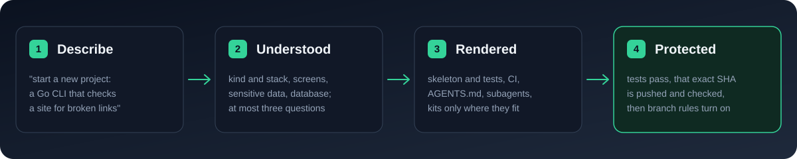
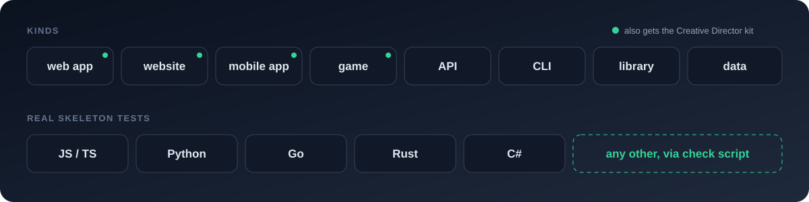
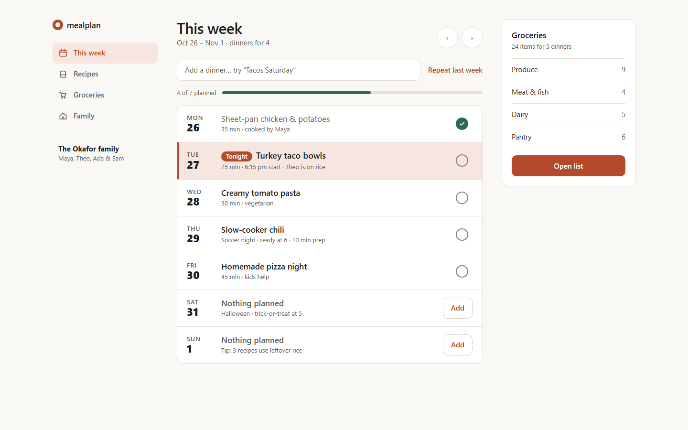
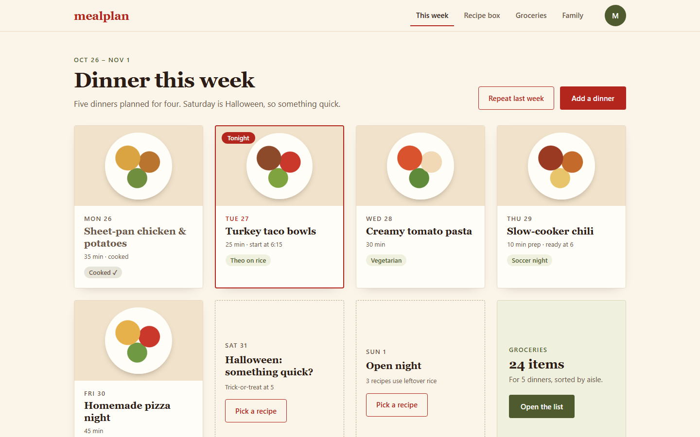

<p align="center">
  
</p>

<p align="center">
  
  
  
  
  <a href="LICENSE"></a>
</p>

<p align="center">
  <b>Start every project the way a careful senior engineer would.</b><br>
  Tell Claude what you're building; get tests, cheap CI, GitHub protections and agent instructions tailored to it.
</p>

## Quick start

1. **Install the plugin.** From your terminal:

   ```text
   claude plugin install project-starter --marketplace trexchery/project-starter
   ```

   Or inside Claude Code, in two steps:

   ```text
   /plugin marketplace add trexchery/project-starter
   /plugin install project-starter@project-starter
   ```

2. **Say what you want.** "start a new project: a Go CLI that checks a site for broken links", or run
   `/project-starter:new-project`.
3. **Answer at most three questions.** Claude creates the repository, fills in the brief and project rules from the
   conversation, runs the tests, pushes, checks GitHub has that exact SHA, and only then turns on protection.

> While the repository is private, installing needs read access to `trexchery/project-starter` and git credentials
> for it (`gh auth setup-git`).

<details>
<summary>Use it from your own terminal (no Claude Code)</summary>

Needs Node 22+, git, and `gh` for GitHub.

```powershell
npm install -g github:trexchery/project-starter
proj new <name> "what you are building"
```

On Windows, if `proj` is not found afterwards, install into the per-user npm folder:
`npm install -g --prefix "$env:APPDATA\npm" github:trexchery/project-starter`.

</details>

## How it works

<p align="center">
  
</p>

`proj new` prints what it understood and why. Flags override it (`--visual`, `--no-visual`,
`--sensitive auth,payments`, `--database`, `--stack python`), and `--profile file.json` sets everything exactly.

## Fits what you build

<p align="center">
  
</p>

Node/TypeScript, Python, Go, Rust and C# projects start with a passing skeleton test. Any other language gets
`scripts/check.ps1`, which fails as "NOT VERIFIED" until it runs a real test command; the `new-project` skill sets
that up with you.

| The description mentions | The project also gets |
| --- | --- |
| screens: a web app, website, mobile app or game | the Creative Director kit: `/creative-director` skill, `design-researcher` and `visual-critic` agents, `DESIGN.md`, UI rules |
| accounts, payments, personal data or stored keys | a `security` reviewer agent, rules scoped to auth and payment code, a "Sensitive areas" section |
| a database | migration and test-isolation rules scoped to schema code |
| `--tasks` | session hooks and the optional task workflow ([utilities](docs/UTILITIES.md)) |

## What every project gets

<table>
<tr>
<td width="33%" valign="top">

**Agents**

- `AGENTS.md` as the one source of truth, `CLAUDE.md` importing it
- `scout`, `implementer`, `reviewer`, `deep` subagents, each with its own model and effort
- matching Codex agents

</td>
<td width="33%" valign="top">

**Checks**

- a real test, or an honest "NOT VERIFIED"
- CI free on draft PRs, once per commit when ready
- a skipped run never counts as passed

</td>
<td width="33%" valign="top">

**GitHub**

- a private repository, squash-only merges
- a ruleset that requires the CI check
- Dependabot, issue and PR templates

</td>
</tr>
</table>

## Your model stays yours

Nothing in a generated project sets the main session's model, reasoning effort, or Ultracode and workflow use:
those stay your choice. Each subagent declares its own model and effort, and `AGENTS.md` routes cheap work to cheap
tiers and escalates only after a failed attempt.

## Existing repositories

```powershell
proj adopt --dry-run     # what it would add, based on what the repo looks like
proj adopt               # adds missing pieces, never overwrites a file
proj adopt --upgrade     # later: refresh starter files you never edited
proj protect             # squash-only merges, Dependabot, ruleset
```

> [!NOTE]
> **Safety contract.** `proj` never uses `--force`, never deletes a branch or worktree without an archive ref and
> proof that it was merged, and never re-runs CI for a commit that already passed.

<details>
<summary>Creative Director (visual projects only)</summary>

`/creative-director` researches references, renders three deliberately different directions as real pages with
desktop and mobile screenshots, has `visual-critic` review them blind, and stops for your choice. Only then does it
write `DESIGN.md`, which every later UI change is checked against.

<p align="center">
  
  
</p>

The full run and four generated projects are in [docs/EXAMPLES.md](docs/EXAMPLES.md).

</details>

<details>
<summary>Optional utilities</summary>

Task worktrees with crash recovery, exact-commit verification, CI cost profiling, self-hosted runners, remote
compute and repo health audits are available but never required: see [docs/UTILITIES.md](docs/UTILITIES.md).
`proj help` lists every command.

</details>

<details>
<summary>Develop</summary>

`npm test` runs the suite (temp repos, local bare remotes, no network) in under a minute.
`node scripts/gen-workflows.mjs` regenerates the stacks' CI workflows from one source.

</details>

<p align="center"><sub>MIT · Not affiliated with Anthropic</sub></p>
