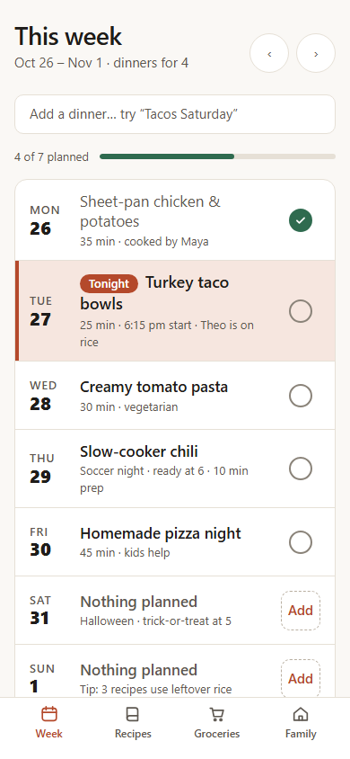
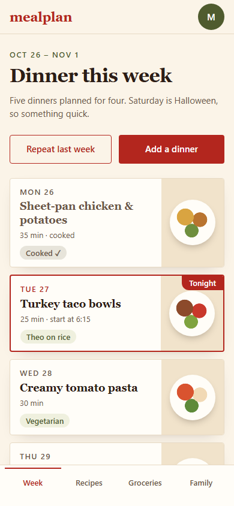
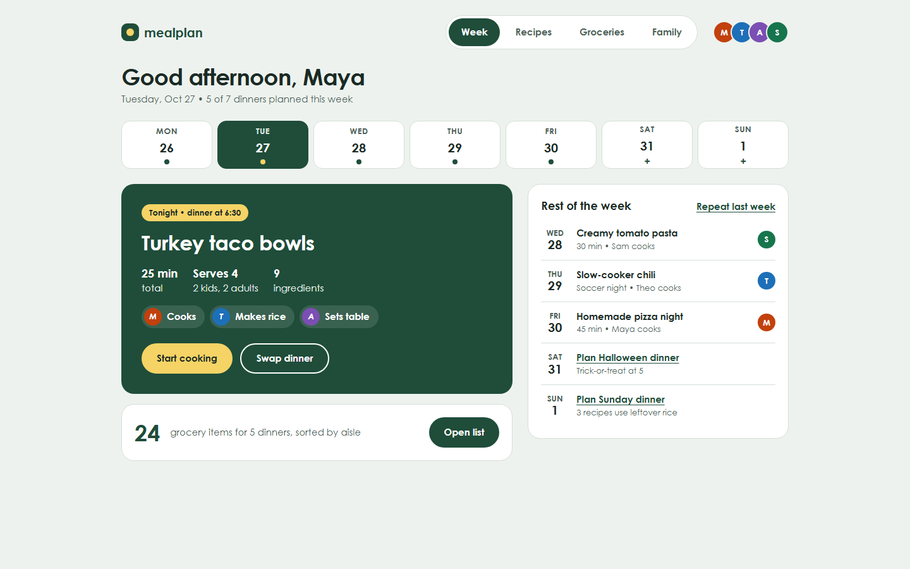
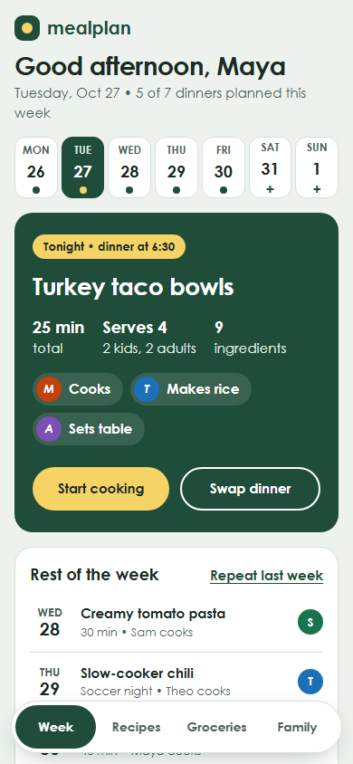

# Examples

Four fresh repositories made with `proj new <name> "<description>" --no-remote`, with nothing edited by hand. They
show the same tool handing different projects different foundations. Each generated test or check passed in its
repo (exit 0).

| Description | Understood | Files | Subagents | Check |
| --- | --- | --- | --- | --- |
| A web app where families plan weekly meals, share recipes and pay a monthly subscription with Stripe; accounts, Postgres database | web-app on node · visual (Creative Director kit) · security reviewer for auth, payments · database rules | 42 | scout, implementer, reviewer, deep, security, design-researcher, visual-critic | `npm test` |
| A Python command-line tool that cleans and validates CSV exports | cli on python · no visual kit · no sensitive data | 31 | scout, implementer, reviewer, deep | `python -m pytest` |
| A small TypeScript library for structured logging | library on node · no visual kit · no sensitive data | 32 | scout, implementer, reviewer, deep | `npm test` |
| A Rust service that ingests telemetry from field sensors | api on generic · no visual kit · no sensitive data | 29 | scout, implementer, reviewer, deep | `scripts/check.ps1` (placeholder until the `new-project` skill sets up `cargo test`) |

What differs between them:

- **mealplan** gets `DESIGN.md`, the `/creative-director` skill, UI rules scoped to UI files, a `security` agent
  (opus, high), security rules scoped to auth and payment code, and database rules scoped to schema and migration
  files. Its `AGENTS.md` has "Sensitive areas: accounts and login, payments", "Database" and "Design" sections.
- **csvkit**, **tinylog** and **rover** get no design, security or database files at all. A test asserts that the
  CLI's file list contains none of them.
- Every `AGENTS.md` carries one rule for its kind. The web app gets "Every screen works at 390px and 1440px wide
  and by keyboard alone"; the CLI gets "Exit 0 only on success; errors go to stderr; output other programs read
  stays stable".
- None of them set the main session's model, effort or Ultracode. Every subagent declares its own `model` and
  `effort`, and a test checks both on every generated agent.
- None of them need `proj` after creation. Task hooks appear only with `--tasks`, and the only `proj` mention
  (`proj shot`, in the visual kit) also names a plain headless-browser fallback.

When the description leaves something out, the output says so. Without a recognizable kind, for example, it prints
`guessed kind (the description does not say): override with --kind / --stack if wrong`. In a terminal it then asks
before creating anything.

## The Creative Director, on mealplan

In Claude Code, `/creative-director` ran on the generated repo:

1. The brief named busy parents and the feel "warm, calm, efficient", phone first.
2. `design-researcher` wrote `design/research.md`: 8 references (Things 3, NYT Cooking, Mealime, Plan to Eat,
   Sunsama, Fantastical, Cozi, Paprika), each with the one pattern worth taking. It flags which visual details it
   could not verify from the web.
3. Three deliberately different directions were built as static pages, then shot at 1440×900 and 390×844 with
   `proj shot`.
4. `visual-critic` scored each one from the screenshots and the brief only, never seeing the designer's
   reasoning. Clear defects were fixed and re-shot.
5. The run stopped for the owner's choice. No screens were built and `DESIGN.md` stayed pending.

| Direction | Critic | Main concern |
| --- | --- | --- |
| A. Quiet List: one calm checklist, a single terracotta accent | 6.5/10 | Tonight was not the loudest row; little food warmth |
| B. Kitchen Table: serif on cream, a plate illustration per dinner | 6/10 | Decoration before the task; the finished Monday showed first |
| C. Family Board: tonight first, week strip, who's cooking, deep green with butter yellow | 7/10 | Calm but not warm: reads close to a banking app |

The scores are for the first round of screenshots. These are the re-shot pages after the fixes:

| | Desktop | Mobile |
| --- | --- | --- |
| A |  |  |
| B |  |  |
| C |  |  |

Reproduce it with `proj new mealplan "<the description above>" --no-remote`, then open the folder in Claude Code and
run `/creative-director`.
