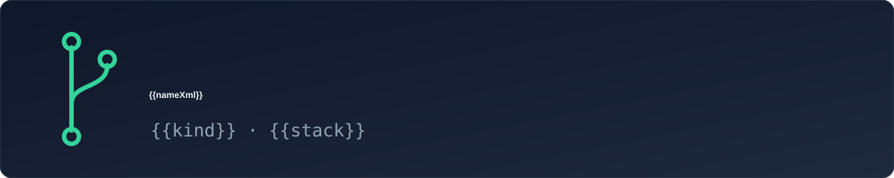

<p align="center"></p>

# {{name}}

{{description}}

## Quick start

```text
{{#setupCmd}}
{{setupCmd}}
{{/setupCmd}}
{{testCmd}}
```
{{^verified}}

> [!WARNING]
> NOT VERIFIED: `{{testCmd}}` exits 2 until `scripts/check.ps1` lists this project's real test command.
{{/verified}}

## Develop

Work on a branch, open a draft pull request, mark it ready when the full suite passes on the final commit
(CI runs once per commit, only on ready pull requests).{{#tasks}} The optional `proj` helper automates this:
`proj task <slug>`, `proj ready`, `proj finish <slug> --merge`.{{/tasks}}

Brief: [docs/BRIEF.md](docs/BRIEF.md) · Decisions: [docs/DECISIONS.md](docs/DECISIONS.md){{#visual}} · Design: [DESIGN.md](DESIGN.md){{/visual}} · Agents: [AGENTS.md](AGENTS.md)
